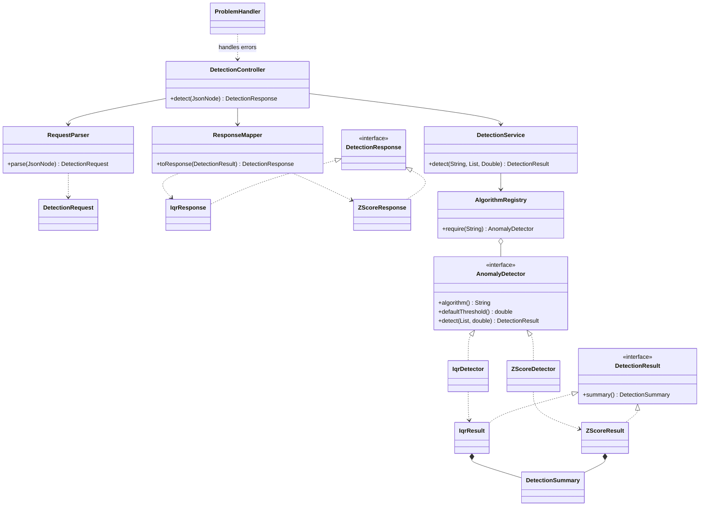

# Architecture

One Maven application keeps the interview reading path short:
`DetectionController` → `RequestParser` → `DetectionService` → `AlgorithmRegistry` → `AnomalyDetector`.
`ResponseMapper` converts typed core results into flat API responses. `ProblemHandler` owns all
HTTP errors. `DetectionConfiguration` wires these objects with constructor injection. The core
package imports neither Spring nor Jackson and can run directly in JUnit.

The small Strategy contract isolates the algorithm. The immutable registry is built once from
injected strategies and selects by exact identifier; adding a detector does not edit a selection
switch. The additional test detector demonstrates this. The service owns selection/defaults;
detectors own statistics/classification. API parsing checks JSON node types directly because
default coercion would accept numeric strings and collapse omitted/null parameters.

`DetectionSummary` shares status, warnings, effective threshold and immutable ordered partitions.
`DetectionResult` only requires that summary. `IqrResult` and `ZScoreResult` retain their typed
statistics without placing algorithm-specific fields on the common contract. API responses are separate so HTTP schema annotations and
wire layout never leak into the statistical core. Mapping each result type at the API boundary
is deliberate: adding an algorithm needs an explicit documented wire shape.

## Class diagram

The diagram shows the meaningful production relationships, omitting configuration, enums and
arithmetic/validation helpers. It is a Mermaid **class diagram**, with no planned future classes.

## Why these choices

- Single responsibility: HTTP parsing/mapping, selection and statistical calculation change for
  different reasons and have separate small classes.
- Open/closed and dependency inversion: selection depends on `AnomalyDetector`; Spring wires the
  concrete implementations. The contract documents immutability, ordering and invalid arithmetic.
- Interface segregation: one small strategy contract and one common result contract; no helper
  interface hierarchy or framework-sized generics.
- Request isolation: detectors and registry hold no per-request mutable state. Copies and local
  loops preserve caller data, duplicate values and order under concurrent calls.
- Tests independently calculate expected statistics. Real random-port HTTP tests cross serialization,
  validation, registry, algorithms, error handling and profile configuration together.

IQR costs O(n log n) time for sorting a copy and O(n) auxiliary memory. Classification scans the
original data once. Z-Score uses Welford population statistics followed by classification in O(n)
time and O(n) memory for the input copy and ordered partitions. Zero variance is normal with a
warning; unsafe intermediate overflow/variance underflow returns a typed numerical error.
Registry lookup costs expected O(1); parsing costs O(n), and response mapping shares immutable
lists in O(1) (HTTP serialization still costs O(n)).
The API is synchronous and in-memory, intentionally small enough to read and explain.
