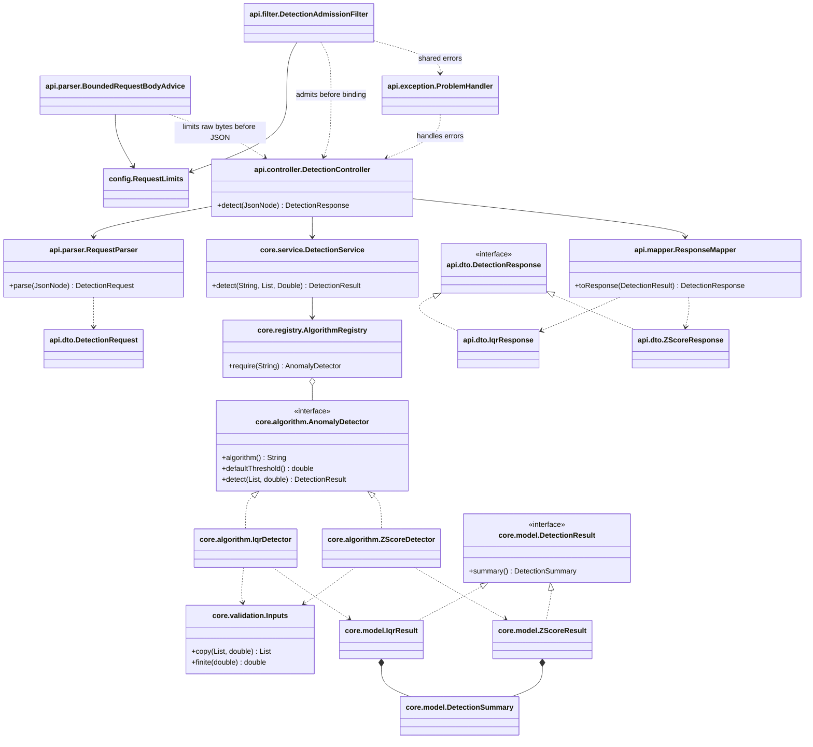

# Architecture

One Maven application keeps the interview reading path short:
`DetectionController` → `RequestParser` → `DetectionService` → `AlgorithmRegistry` → `AnomalyDetector`.
`ResponseMapper` converts typed core results into flat API responses. `ProblemHandler` owns all
HTTP errors, including filter rejection through the same problem factory. `DetectionConfiguration` wires these objects with constructor injection. The core
package imports neither Spring nor Jackson and can run directly in JUnit.

The small Strategy contract isolates the algorithm. The immutable registry is built once from
injected strategies and selects by exact identifier; adding a detector does not edit a selection
switch. The additional test detector demonstrates this. The service owns selection/defaults;
detectors own statistics/classification. API parsing checks JSON node types directly because
default coercion would accept numeric strings and collapse omitted/null parameters.

`DetectionSummary` shares status, warnings, effective threshold and immutable ordered partitions.
`DetectionResult` only requires that summary. `IqrResult` and `ZScoreResult` retain their typed
statistics without placing algorithm-specific fields on the common contract. API responses are separate so HTTP schema annotations and
wire layout never leak into the statistical core. Mapping each result type at the API boundary
is deliberate: adding an algorithm needs an explicit documented wire shape.

## Package and source navigation

All production paths start at `src/main/java/io/anomaly/`; the application scans io.anomaly.
The Maven groupId is io.anomaly. Java import compatibility changed; the HTTP contract did not.

| Relative package | Production classes |
| --- | --- |
| root | AnomalyApplication |
| config | DetectionConfiguration, RequestLimits |
| api.controller | DetectionController |
| api.dto | DetectionRequest, DetectionResponse, IqrResponse, ZScoreResponse |
| api.mapper / api.parser | ResponseMapper / RequestParser, BoundedRequestBodyAdvice |
| api.filter | DetectionAdmissionFilter |
| api.exception | InvalidRequestException, InputTooLargeException, ProblemHandler |
| core.algorithm | AnomalyDetector, IqrDetector, ZScoreDetector |
| core.service / core.registry | DetectionService / AlgorithmRegistry |
| core.model | DetectionResult, DetectionSummary, DetectionStatus, WarningCode, IqrResult, ZScoreResult |
| core.validation / core.exception | Inputs / NumericalRangeException, UnsupportedAlgorithmException |

Start with [IQR](../src/main/java/io/anomaly/core/algorithm/IqrDetector.java),
[Z-Score](../src/main/java/io/anomaly/core/algorithm/ZScoreDetector.java),
[service](../src/main/java/io/anomaly/core/service/DetectionService.java), then
[controller](../src/main/java/io/anomaly/api/controller/DetectionController.java).
Unit packages mirror roles; real HTTP *IT tests use io.anomaly.integration.api and shared support
uses io.anomaly.support. Inputs and DetectionSummary.forData are public only for cross-role use,
with documented contracts; no new helper interface or module is introduced.

## Class diagram

The diagram shows the meaningful production relationships, omitting the composition root, enums and
small exceptions. Diagram labels show packages relative to io.anomaly. It is a Mermaid **class diagram**, with no planned future classes.

## Why these choices

- Single responsibility: HTTP parsing/mapping, selection and statistical calculation change for
  different reasons and have separate small classes.
- Open/closed and dependency inversion: selection depends on `AnomalyDetector`; Spring wires the
  concrete implementations. The contract documents immutability, ordering and invalid arithmetic.
- Interface segregation: one small strategy contract and one common result contract; no helper
  interface hierarchy or framework-sized generics.
- Request isolation: detectors and registry hold no per-request mutable state. Copies and local
  loops preserve caller data, duplicate values and order under concurrent calls.
- Tests independently calculate expected statistics. Real random-port HTTP tests cross serialization,
  validation, registry, algorithms, error handling and profile configuration together.

IQR costs O(n log n) time for sorting a copy and O(n) auxiliary memory. Classification scans the
original data once. Z-Score uses Welford population statistics followed by classification in O(n)
time and O(n) memory for the input copy and ordered partitions. Zero variance is normal with a
warning; unsafe intermediate overflow/variance underflow returns a typed numerical error.
Registry lookup costs expected O(1); parsing costs O(n), and response mapping shares immutable
lists in O(1) (HTTP serialization still costs O(n)).
The API is synchronous and in-memory, intentionally small enough to read and explain.

008 changes only IQR's private sort workspace to a primitive double array. The validated original
Double snapshot remains the source of ordered immutable partitions, preserving the 007 reference
reuse benefit. Median-of-halves indices, overflow/subnormal arithmetic and signed-zero ordering
remain unchanged. Profile/measurement evidence is in performance/008; the class relationships above
remain actual and unchanged. Parsing, limits, admission and Z_SCORE were not refactored.

v0.3 reuses immutable Double references in classification partitions, retaining primitive
arithmetic, defensive snapshots and eager immutable FULL results. No primitive-model migration
or deferred work is involved. A servlet filter takes an immediate semaphore permit before body
binding and holds it through synchronous response writing. A Spring RequestBodyAdvice uses
JDK readNBytes(limit + 1) before Jackson to bound actual raw bytes, then a positive configured
number-count policy bounds conversion. This adds a bounded raw-body buffer; memory observations
and concurrency tests must account for it. All request state remains local; the semaphore is
only operational admission state. Docker/nginx scale copies of this same modular application.
